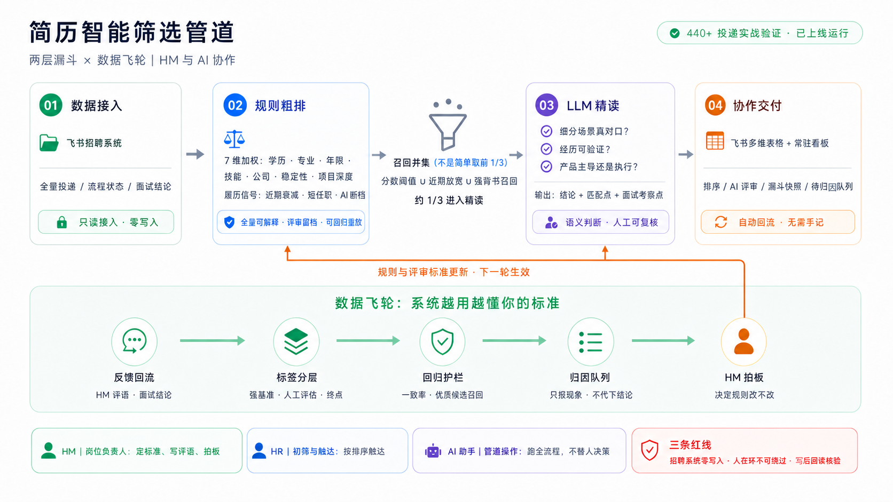

# hire-screening-kit

面向**飞书招聘生态**的简历筛选管道套件:HM + Claude 协作的**两层漏斗**(规则粗排 → LLM 精读)+ **数据飞轮**(标签中心化 / 回归护栏 / 半自动归因 / 常驻看板),从一次真实招聘运营(440+ 投递、5 轮人工校准、多轮面试信号回流)中沉淀。

> 定位:**方法论 + 参考实现**,不是开箱即用的 SaaS。目标用户是用飞书招聘 + 多维表格的 HM / 招聘团队,由一个 AI 编程助手(Claude Code / Codex)陪跑运营。
>
> **协作假设**:团队成员都在飞书办公,每人本机有 AI 编程助手与 lark-cli;HR/HM 只碰飞书表格,管道由任一成员的 AI 助手操作。角色分工见 [playbook/TEAM-GUIDE.md](playbook/TEAM-GUIDE.md);AI 助手打开本仓会自动读 [CLAUDE.md](CLAUDE.md)/[AGENTS.md](AGENTS.md) 自举上手。



## 三层结构

| 层 | 内容 | 在哪 |
|---|---|---|
| 内核 `core/` | 评分引擎、精读网选择器、批次合并+劣化哨兵、标签库、回归护栏、归因队列、看板生成 | 本仓 |
| 适配 `adapters/feishu/` | 飞书招聘/多维表格/文档的读写脚本 + 实测踩坑库 | 本仓 |
| 私有实例 | 具体岗位的词表、公司名单、rubric 实文、候选人数据、token | **不在本仓**,以配置目录形式被引用 |

设计原则:**代码是机制,配置是策略**。所有岗位判断(关键词、公司分层、阈值、权重)都在一个 TOML 配置里,换岗位不改代码。

## 核心理念(详见 playbook/)

1. **两层漏斗**:规则层管全量排序与召回网,LLM 层管语义辨识(方向匹配 / owner-vs-执行 / 自陈美化)。规则层不追求聪明,追求可解释、可回归。
2. **人在环不可让渡**:归因只报现象,规则与 rubric 改动必须人拍板;LLM 不直接淘汰任何人。
3. **护栏先于优化**:每次改规则先"模拟不落盘"跑全量,血范围看"谁进出精读网"而不是"多少人分数变了";改动能否复现基线是硬验收。
4. **踩坑资产化**:飞书 API 的每个实测坑都写进 `adapters/feishu/PITFALLS.md`,新接入者不再重踩。

## 环境要求

- Python ≥3.11。内核和本地 smoke 只使用标准库。
- 飞书适配需要 `jq`、`lark-cli` 和 bot、user 两种认证身份。
- 本地开发与验证步骤见 [参与贡献](CONTRIBUTING.md)。

## 用法(规则层)

```bash
python3 core/score_engine.py --config <你的私有岗位配置.toml> --workspace <数据目录> [--out-dir <输出目录>]
```

配置格式见 [config/example.toml](config/example.toml)(全字段注释,含各阈值的校准方法)。数据目录的输入文件由飞书适配层产出(见 [adapters/feishu/](adapters/feishu/))。

## 快速开始

新岗位接入按 [playbook/QUICKSTART.md](playbook/QUICKSTART.md)(约 30-60 分钟);团队成员(HR/HM/操作员)各自怎么用见 [playbook/TEAM-GUIDE.md](playbook/TEAM-GUIDE.md);设计依据见
[playbook/METHODOLOGY.md](playbook/METHODOLOGY.md);精读 rubric 起草见
[playbook/RUBRIC-GUIDE.md](playbook/RUBRIC-GUIDE.md);运营 SPEC 模板见
[playbook/SPEC-TEMPLATE.md](playbook/SPEC-TEMPLATE.md)。

## 运营统计（脱敏）

数据截止 2026-11-13。以下为聚合统计，少于 5 人的阶段统一显示为 `<5`。

| 指标 | 数值 |
|---|---|
| 累计投递 | 1,011（在招 956 / 已终止 54 / 已撤回 1） |
| 进入 LLM 精读网 | 652（64.5%） |
| 人工评估 / 面试强标签 | 127 条（另有 80 条参考标签） |
| 规则总分中位 | 62.8（P25 51.7 / P75 73.5） |

| 阶段 | 人数 |
|---|---|
| 简历初筛 | 79 |
| 简历评估 | 675 |
| 评估通过 | 56 |
| 一面 | 124 |
| 二面 | 44 |
| 三面 | 12 |
| 四面 | `<5` |
| 面试通过 | 7 |
| Offer沟通 | `<5` |
| 待入职 | `<5` |
| 已入职 | 7 |

## 状态

P1(内核+适配层移植)与 P2(playbook+quickstart)已完成:核心引擎与飞轮五件均通过与原产线的
**回归等价验收**(产物 zero-diff),适配层本地件同输入 zero-diff、拉取件已只读实测;
写路径件(sync/dashboard_sync/flywheel)静态移植,待下轮真实运营轮实测。
明细见 [ARCHITECTURE.md](ARCHITECTURE.md) 移植地图。

## 红线

- 本仓任何提交不得包含:候选人 PII、简历文本、内部 token/文档 id、真实岗位 job_id、公司真实评估名单。
- 推送前运行 `bash tools/sensitive_scan.sh`。默认使用通用模式表。维护者用 `SENSITIVE_PATTERNS` 指定仓外的私有模式表。
- 启用推送钩子后，还会扫描提交说明和待推送补丁。发布前须单独核查全历史。
- 安全问题请按 [上报流程](SECURITY.md) 私下反馈。

## License

本项目采用 [MIT License](LICENSE)。
