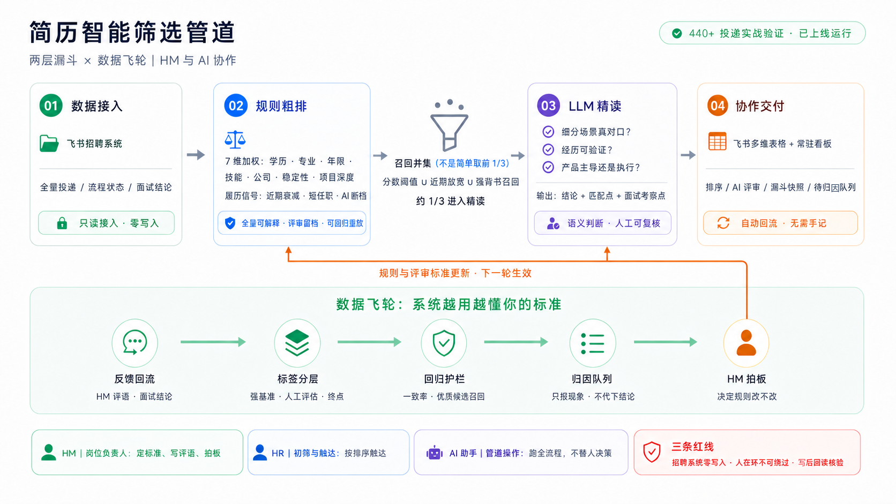

# 团队使用指南(HR / HM / 操作员一页纸)

协作假设:团队成员都在飞书办公;每人电脑装有 AI 编程助手(Claude Code / Codex)与
`lark-cli`;**所有人机交互都发生在飞书里**——结果表、常驻看板、飞书消息,没有别的界面。



## 0. 三个角色

| 角色 | 你碰什么 | 你不用碰什么 |
|---|---|---|
| **HM**(岗位负责人) | 自己岗位的结果表:看粗排名与 AI 意见、写人工评语、拍板规则调整 | 代码、命令行、配置 |
| **HR**(初筛/触达) | 同一张表:按粗排名和 AI 建议触达候选人、更新触达情况 | 同上 |
| **操作员** | 用自己的 AI 助手跑管道(拉简历/评分/精读/同步/飞轮) | —— |

**任何装了 Claude Code/Codex + lark-cli 的成员都可以当操作员**——克隆本仓后对 AI 助手说
"读一下仓库里的 CLAUDE.md,然后按 QUICKSTART 给岗位 X 建实例",AI 会自己上手。
每个岗位建议固定一名操作员,避免两人同时对同一张表跑同步(竞态)。

## 1. 结果表怎么读(HR/HM 都适用)

**核心三列**:`总分`(规则层排序)、`LLM建议`(推荐面试/待定/不推荐)、`LLM评审意见`(为什么)。

`LLM评审意见` 的排版是给面试场景设计的——**头部两块速查,可整块复制进面试记录**:

```
🎯 推荐面试 · A-方向一 · 85分
📌 匹配点            ← 面试前 30 秒扫这块:他哪里对口
1. …  2. …  3. …
🔍 面试重点考察      ← 面试时照着问:哪里要验证
1. …  2. …  3. …
─────────
📋 评审详述          ← 需要追溯判断依据时再看
```

正确用法:
- **推荐面试 ≠ 必须约面**,它是"值得人看 3 分钟"的意思。最终判断永远是人的。
- **待定的价值在评审意见里**:AI 会写明缺口是什么、面试该验证什么——那是现成的面试问题清单。
- **"风险"里的条目不是罪状**,是"面试时问这个"的提示(尤其前沿工具名类:让候选人讲选型取舍和一手细节)。
- `方向匹配` 区分候选人贴近哪个子方向;`顶尖背书`/各分项分是排序依据的拆解,供追溯,平时不用管。
- `当前阶段`/`状态`、**面试结论与面评**都由系统从招聘系统自动回流——**面试之后的一切进展都不用在表里手记**;表里唯一需要人写的是简历层面的「简历评估（人工）」。

**列的读写规则(重要)**:

| | 列 |
|---|---|
| 🤖 系统维护,**手改会被下轮覆写** | 粗排名/总分/各分项分/顶尖背书/简历评价/状态/当前阶段/LLM评分/LLM建议/LLM方向/LLM评审意见 |
| ✍️ 给人写的 | **简历评估（人工）**,以及你们自建的任何触达/备注列 |

常驻看板文档同理:**纯机器生成、每轮全量覆写**,别在上面编辑或划词评论,讨论请拉群或另开文档。

## 2. 人工评语怎么写(HM 必读——这是你校准系统的唯一接口)

在「简历评估（人工）」列写,**以【通过】/【待定】/【不通过】开头**,首行可加"排名偏高"或
"排名偏低"提示,后面自由写理由(一两句即可,写清"为什么"最有价值):

> 【不通过】排名偏高。做的是客服工单审核,不是平台建设。

系统每轮自动回收这些评语:与 AI 判断不一致的会进"待归因队列",由操作员陪你逐条过——
**要不要改规则永远由你拍板,系统只报现象**。不按格式开头也不会丢,只是会被标成"格式待确认"等人工归类。

## 3. HM:新开一个岗位要做什么

给操作员三样东西,然后等半小时到一小时:
1. **JD**(含子方向划分,如果有);
2. **你心中的 bar**:口头描述 + 两三个"这种我要/这种我不要"的例子(有真实简历最好);
3. **飞书里建一张空的结果表**(或让操作员建),给出链接。

**冷启动期预期(重要)**:头几轮系统只是"辅助排序",别当可信过滤器——名单和关键词还没被你的
反馈校准过。你每周花十分钟写 5-10 条人工评语,两三轮后系统会明显"懂你"(这套机制在原型岗位
上迭代过五轮、覆盖 440+ 投递)。

## 4. HR:怎么用

- 按 `粗排名` + `LLM建议` 决定触达顺序;`详情页链接` 直达招聘系统候选人页。
- 触达结果(已联系/微信未回复/约面中…)记在**自建触达列**里,不要写进「简历评估（人工）」——
  那一列专门给"对简历本身的判断"。**"没回复"不是"这人不行"**,两者混在一起会教坏系统。
- 发现表里数据不对(粗排名怪、阶段滞后),在群里 @操作员 即可,不要手改系统列。

## 5. 权限建议(建表时设一次)

- 结果表:HM/HR **可编辑**(要写评语和触达列),其他人只读。
- 若 HR 标注需要与 HM 评估隔离(如敏感岗位),给 HR 单独建标注表——原型项目验证过这种隔离模式。
- 常驻看板文档:所有人只读。
- bitable app_token 等同访问凭证,只在私有 env 文件里传递,不进聊天记录。

## 6. 飞书里的人机交互约定

- AI 助手代发的消息/评论,**开头声明身份**(如 `{role: 某某's Claude}`),让同事知道在和谁说话。
- AI 批量写表后必须回读核验并向人报告结果(操作员侧纪律,详见 adapters/feishu/PITFALLS.md)。
- 写外部系统的动作(同步表格、覆写看板)由在场操作者逐轮确认,**不设无人值守定时任务**。

## 7. 操作员:第一次上手

```bash
git clone <本仓>   # 然后用 Claude Code / Codex 打开仓库,对 AI 说:
# "读 CLAUDE.md,按 playbook/QUICKSTART.md 给岗位 X 建一套实例"
```

第一道坎是 lark-cli 双身份认证(bot 读招聘 + user 写表格,权限是两段式的)——AI 会带你过,
细节在 [adapters/feishu/PITFALLS.md](../adapters/feishu/PITFALLS.md) 第一节。
